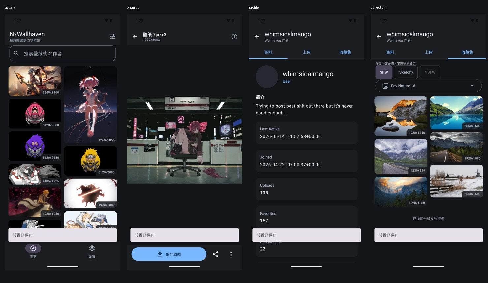

# Android 0.1.0-alpha01：首版实现与验收

## 当前成果

Android 已从空目录建立为可安装、已在模拟器运行的原生 APP，不是静态界面、网页套壳或只编译成功的骨架。延续方案 B：Kotlin + Compose Multiplatform 插件 / Android Material 3，Rust 共享业务通过 UniFFI 接入。Windows Rust + Slint 不重写，桌面源码本轮无修改，已有 EXE 哈希未变。

**这是开发测试版，不是正式生产发行。** 首版完成浏览、完整原图、原生作者、文件缓存/保存与设置；网页登录、账号私有收藏及收藏写入仍在下一阶段。

## 可用功能

- 中文原生 Material 3 界面，跟随系统/深色/浅色主题。
- 真实公开 API 搜索，关键词、分类、SFW/Sketchy/获准的 NSFW、排序、最低分辨率、比例、颜色等筛选。
- 默认原比例双列瀑布流，横屏三列，统一方格为显式设置；下拉刷新、近底自动续载、去重、空/重复页停止、错误重试。
- 详情原图与元数据并行获取，原图文件从本地分块解码，双指/双击缩放、拖动；不把缩略图当成完整原图，不把超大原图一次全部展开成 Java RGBA。
- 标签/颜色搜索、原生作者资料、上传作品和公开收藏内容；作者分级继承并可独立选择。
- 保存原图至 `Pictures/NxWallhaven`（Android 10+ MediaStore）；另有系统文件选择导出、原图分享、主屏/锁屏壁纸入口，设置壁纸先确认。
- Android 8/9 保存使用系统文件选择器，不申请无必要的全部存储访问权限。
- API Key 用 Android Keystore AES-GCM 加密，普通设置文件只有密文/IV；空白输入保留 Key，显式删除；NSFW 默认关闭，不因有 Key 自动选中。
- 设置显示实际图片缓存用量、路径和清理确认，主题/网格等偏好落盘。
- 详情与返回来源列表保留滚动；已实测非顶部卡片打开详情、Activity 重建后返回的位置。

## 模块与构建

| 位置 | 职责 |
|---|---|
| `composeApp` | Android Activity、Compose 原生页面、ViewModel、Keystore、MediaStore/SAF/分享/壁纸适配 |
| `shared` | Kotlin 业务数据、代数保护分页累加器、工作线程上的 Rust 调用适配 |
| `rust/core` | 继续复用现有 API、模型、限流 |
| `rust/android` | UniFFI `MobileCore`，公开作者读取、图片文件缓存与脱敏错误 |
| `scripts/build-android.ps1` | 生成 Kotlin 绑定、构建两种 ABI、编译/检查并复制 APK，核对副本哈希 |
| `scripts/test-android-emulator.py` | 显式选择专用模拟器，运行设备与独立进程探针，退出时恢复网络并关闭自己启动的模拟器 |

实际已用工具链：JDK 21.0.6、Gradle 9.8.0、AGP 9.4.1、Kotlin 2.4.21、Compose 插件 1.12.2、UniFFI 0.32.2、cargo-ndk 4.1.2、NDK 27.0.12077973。`compileSdk=37` 是依赖要求，**minSdk=26 / targetSdk=36 不变**。Rust Android `aarch64-linux-android` 与 `x86_64-linux-android` 均已实际构建。

Windows PowerShell 构建：

```powershell
cd D:\Code\wallhaven
# 已安装 Rust、JDK21、Android SDK平台37 / build-tools37、NDK27，设置 ANDROID_HOME
rustup target add aarch64-linux-android x86_64-linux-android
cargo install cargo-ndk --version 4.1.2 --locked
.\scripts\build-android.ps1 -Tests
# 或显式指定 JDK：-JavaHome 'D:\Program Files\Android\Android Studio\jbr'
```

生成的 Kotlin 绑定及 `jniLibs` 已忽略，由脚本重建。直接在空白 clone 运行 Gradle 前须先执行该脚本，不提交本机 `.so`、调试密钥、配置或缓存。

Android TLS 使用系统证书信任库：包含 `org.rustls:rustls-platform-verifier:0.2.0` 的 JVM 支持，并在 Application 启动、任何 Rust 网络请求前初始化 JNI 上下文。没有关闭证书验证。

原图分块查看库当前依赖 AndroidX Jetifier 转换，已实际修复旧 Exif 类缺失导致的崩溃；Jetifier/部分 Compose 旧入口仍有弃用警告，未承诺 AGP 10 兼容。

## 缓存与下载的正确区别

- 图片文件缓存在 Android 应用私有 `cacheDir/images`，本机模拟器路径形如 `/data/user/0/io.github.nuxoul.nxwallhaven/cache/images`。
- 缓存是压缩原始图片文件，不是只存内存像素；图库绘制只读取本地文件，Coil 不包含网络加载器。
- 同 URL 的进行中请求合并，预览/保存共享原图获取入口；已有完整缓存时直接复制原始字节，不第二次请求、不重新编码。
- 缓存文件为哈希命名的完整文件及校验元数据；临时文件、长度/SHA-256 和容器校验通过才提交。原始文件不通过 JNI 传成大数组。
- 用量统计包含图片、元数据和应用持有的临时文件字节；文件数表示完整图片数量，不等同进程内存或相册下载数量。
- 默认约 512MiB LRU 软上限，活动/单个超大原图保持完整，可暂时超过软上限；不是原图下载大小限制。
- 清理只删带应用所有权标记的普通文件，不跟随链接、不递归删除无关文件；已保存相册、配置/Key 不动。清理会等待正在进行的获取完成再清除，因此网络慢时可能显示处理中。
- Android 系统可以回收 `cacheDir`，缓存丢失/主动清理/损坏后重新取得属正常行为。应用重启本身不清缓存。

## 实际复现并修复的问题

1. UniFFI 异常字段 `message` 与 Kotlin Throwable 属性冲突：源字段改名为 `reason` 后重新生成绑定，不手改生成代码。
2. 当前 Compose/Coil 依赖要求 compileSdk37：核验本机 SDK37 后更新编译版本，保留最低/目标版本。
3. 缺少 Android 系统 TLS 初始化：接入 verifier JVM 组件和 JNI 初始化，未使用不安全 TLS 绕过。
4. 原图显示实际崩溃 `NoClassDefFoundError: android/support/media/ExifInterface`：Jetifier 转换后同一完整原图设备路径通过。
5. 第一页到达时空列表底栏成为滚动锚点，卡片跳到后面：仅新代第一批结果到达时定位顶部；返回/重建保留原位置。
6. 崩溃留下测试模拟器网络关闭状态：每个测试显式恢复、等待系统验证联网；测试结束也恢复，不把环境故障记为功能通过。
7. 早期截图拍在缩略图加载中：增强测试等待 Coil 实际解码成功，最终截图不再只凭元数据节点判定图片显示。

## 已执行的验证

### Rust / Kotlin / 静态检查

```powershell
cd rust
cargo test --workspace -- --test-threads=1
cargo clippy --workspace --all-targets -- -D warnings
cargo fmt --all -- --check
cd ..
.\scripts\build-android.ps1 -Tests
```

- Rust 手机模块 **14通过**：认证/分级校验、URL来源白名单、公开资料解析、断网新实例缓存、同图并发只一次 GET、不同图并发、截断/坏图、LRU、安全清理、链接拒绝等。
- Rust 共享核心 **38通过/1忽略**，桌面 **121通过/6忽略**，合计 **173项常规测试通过**。
- Kotlin **4项单元测试通过**：分页单在途/去重/耗尽、旧代拒绝与失败重试、权限安全退回、可选字段与原比例缩略图。
- Clippy `-D warnings`、Rust格式检查、Android APK编译通过。
- Android lint **0 errors / 24 warnings**，警告主要是版本升级、弃用和样式建议，不将其说成零警告。

如实记录：一次最终并行 Rust 全量运行中，既有桌面 `concurrent_original_observers_share_one_request_and_pixels` 出现像素指针偶发不相等；单独运行通过，最后串行隔离全量通过。桌面全局清理注册表存在测试间干扰的可能，本轮未修改桌面生产代码，也未删/放宽断言。早先一轮默认并行全量也曾通过，不声称已永久根治并发测试稳定性。

额外只读复核超过限定时间后停止，没有返回结论，不记为通过，也没有展开第二轮评审。

### Android 实际设备测试

专用 `NxWallhavenAcceptance` x86_64 Android 16 / API36 模拟器，使用本机现有镜像、软件渲染并关闭 Vulkan。不使用用户原有 AVD，不连接/操作真实手机。模拟器启动、安装 APK 和测试 APK 均实际成功。

可重复命令：

```powershell
# 先创建专用于测试的 AVD；不要拿个人使用的 AVD 跑写入/网络开关测试
# avdmanager create avd -n NxWallhavenAcceptance -k "system-images;android-36;google_apis_playstore;x86_64" -d pixel_6
.\gradlew.bat :composeApp:assembleDebugAndroidTest --no-daemon
python .\scripts\test-android-emulator.py --avd NxWallhavenAcceptance
```

最终 `AndroidAcceptanceTest`：**OK (4 tests)**：

1. 真实公开列表追加第二页、至少3个缩略图实际解码；滚动到第11张点击完整原图，等待分块显示尺寸，重建 Activity、返回卡片位置与原位置差小于8像素。
2. `whimsicalmango` 原生资料、上传作品及公开收藏内容读取，收藏缩略图实际显示。
3. Keystore 写入伪造测试 Key、密文不含原文、空白保留、重新创建存储读取、显式删除/关闭权限。没有用真实 Key 测试 NSFW。
4. 完整6240×4160原图缓存后断开 Wi-Fi/移动数据，重新实例读取、保存到相册，读取保存文件比对 SHA-256，清缓存保留导出与其他目录文件。

独立进程 `CacheRestartProbe` 分两次显式运行：**prepare通过1项 + offlineAfterRestart通过1项**。两次间实际 force-stop 应用并关闭网络；第二次校验 PID 不同且无已验证网络，读取上次缓存、导出文件并比对哈希，清缓存仍保留导出文件。不只是同一进程内存/同一对象复用。

最终设备运行无原图崩溃，测试网络已恢复，本次模拟器已关闭；`adb devices` 最终无设备。截图：[实际模拟器验收图](assets/android-alpha-acceptance.html)。



## APK 交付

```text
D:\Code\wallhaven\dist\android\NxWallhaven-0.1.0-alpha01-debug.apk
```

- **56,797,328 字节**，约54.2MiB。
- SHA-256：`878DFA96FB5FBC2FE097032EDB40EFC0B56F3F8F623F382534FA0FE49811C7C4`。
- 包名 `io.github.nuxoul.nxwallhaven`，版本 `0.1.0-alpha01` / code1。
- Android8+（API26），包含 `arm64-v8a` 和 `x86_64`。
- `apksigner verify` 通过，**本机 Android Debug 签名**，不是正式发布密钥，不承诺后续正式包可覆盖此调试签名。
- `zipalign -c -P 16 4` 通过；全部6个原生库的 ELF LOAD 段对齐至少16384，通过静态16KB兼容检查，不冒称已在16KB页真机运行。
- 导出副本与本次构建输出 SHA-256 相同，构建失败不会拿旧包冒充新包。
- APK和生成原生库不入Git；本地测试包可直接复制到手机安装。没有擅自创建公开 GitHub Release 或选择许可证。

## 明确尚未完成/验收

- 当前无连接真机，ARM64实际设备、Android8/9 SAF、OEM后台/内存行为、多DPI/横竖屏/手势长时间压力测试未全面验收。
- 主屏/锁屏设置与分享/SAF入口已实现，壁纸设置需确认；本轮没有自动修改真实设备壁纸，也未执行壁纸效果端到端验收。没有壁纸裁切编辑器。
- 原图显示目前为阶段文字和操作进度，不提供逐字节传输百分比；手机不承诺无限资源。
- Activity重建保留状态已测；系统完整回收进程后仅恢复搜索关键词，尚未完整恢复筛选、详情栈和列表位置。
- 网页登录、自己的私有收藏、收藏增删改、完整下载队列、本地图库/统一SQLite及清洗、自动换壁纸未纳入本轮交付。
- 当前 Compose页面和平台适配位于 Android源集，CMP插件已接入，但没有 iOS/其他 Kotlin目标；UniFFI与Rust才是本轮实际跨语言共享链路。

本轮已完成可安装浏览alpha及核心文件缓存闭环，没有将其描述为全部移动端需求完成。
