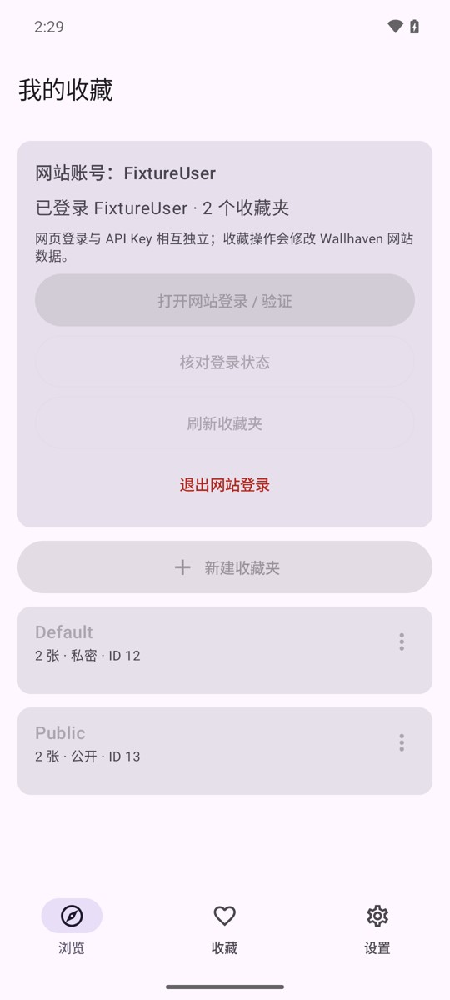

# Android alpha02：网页登录与原生收藏闭环

## 本轮范围与结果

在 alpha01 浏览/原图/文件缓存基础上补齐：**应用内网页登录、会话保留、我的收藏（含私有）、快捷收藏/取消收藏、收藏夹创建/修改名称与可见性/删除**。不是全体移动端缺项一次性完成；下载队列、本地图库/数据库等仍在后续。

版本 `0.1.0-alpha02` / versionCode2。新增功能已编译并在专用 Android 模拟器、本地虚拟站点验证；**未自动登录真实账号、未向真实 Wallhaven 提交增删改，真实网站完整验收仍待本人操作**。

## 功能入口

- 底部新增“收藏”，原生页面显示网站账号状态、收藏夹名称/图片数/公开或私密状态、当前操作结果。
- “打开网站登录”显示应用内 WebView；密码和网站验证只在网页输入。完成后点击“已完成，核对登录”，原生流程重新核对用户身份并读取列表。
- 正常关闭登录页、Activity 重建或应用进程重启不清浏览器数据。明确“退出网站登录”需确认，清理完成后才显示退出。
- 自己的收藏从网站认证入口 `/favorites` 读取，内容从 `/favorites/<id>` 读取，不能用作者公开页代替；保留私有 Default，排除 Trash。
- 收藏内容是原生图片列表，自动续载、分级过滤、原图详情/保存沿用现有实现，不用内嵌网页充当收藏列表。
- 图片详情顶部新增收藏入口，读取新鲜状态后选择网站提供的位置并确认加入；取消收藏另有确认。
- “新建收藏夹”默认私密；编辑名称与可见性；可见性未知时必须主动选公开/私密，不能静默假定；删除显示名称/ID并明确不可撤销。
- 写入结果未知时提示刷新核对，不显示假成功，不自动重新提交。
- API Key 和网页登录彼此独立；网站退出不删除 Key、相册下载或图片文件缓存。NSFW 内容仍要求设置明确允许且当前配置 Key，并显式选择分级，不自动扩大权限。

## 模块与安全规则

### 平台无关站点逻辑

新增 `rust/site`（`wh-site`），从桌面成熟实现移植页面解析、私有列表及分页规则、收藏状态与表单管理，不包含 HTTP Cookie 客户端或 WebView 创建逻辑。桌面代码本轮没有迁移或修改，未声称桌面已改为依赖新 crate。

`rust/android/src/site_bridge.rs` 暴露 UniFFI `MobileSite` 和外部 `BrowserTransport`：

- 请求 `{method,url,fields,csrf}`；响应 `{status,url,body}`。
- Kotlin 回调只交给该应用的会话 WebView，不能以导出 Cookie 或 reqwest 备用客户端代替。
- 最终 URL、HTTP 状态、最大2MiB解码正文、身份与页面结构都校验，错误不包含原始 HTML/Cookie/CSRF。
- 收藏写入前重新核对期待账号及新鲜壁纸页面；管理前后核对账号及列表。
- 写入动作来自网站新鲜页面/表单及 CSRF，不猜测路由，不把删除链接当 GET 跟随。
- 丢失写响应后仅允许读回核对，不自动再次 POST；创建以新增ID、名称和可见性判定，修改/删除也读回验证。

### Android 会话

`account/WebSession.kt`：同一个 WebView 持有 Cookie/站点存储。没有 `addJavascriptInterface`，不读取/导出密码或 Cookie；`evaluateJavascript` 发起同源 fetch，通过返回值轮询取得有界结果。

- 主页面只允许 Wallhaven HTTPS；SSL 错误取消，不绕过证书/安全验证，不伪装指纹或修改 Cookie 寿命。
- fetch 的 GET/POST 均拒绝自动重定向，避免离站请求已经发出后才检查结果；登录页面的同源正常导航由 WebView 执行。特殊同站重定向如未支持则安全失败并提示检查登录，不猜测继续。
- 关闭第三方 Cookie、文件/内容访问、混合内容、表单保存与系统自动填充；使用平台默认 UA，不承诺能绕过站点验证。
- 页面导航、SSL异常、退出/账号代数变化使旧任务失效；阻塞调用在工作线程串行，界面线程不等待网络。
- 普通关闭只 detach/flush；明确退出销毁旧页面、清 Cookie/站点存储及浏览器缓存，等待清理回调后更新原生状态。清理范围仅该应用 WebView 数据，不是系统浏览器。

`account/AccountController.kt`：单个操作锁、账号代数、收藏请求代数、分页代数，防止旧请求覆盖新页面。真正写操作禁用重复按钮，失败不自动重发。

原生界面位于 `ui/Account.kt`；登录页之外，列表、分级、选择/确认、管理弹窗均为 Compose。

## 本轮发现并修复

1. **调试网络配置覆盖证书组件吊销检查域名**：最初 alpha02 网络回归出现 Rust Network。确认 upstream verifier 的网络配置包含获取签名 CRL 所需的受限 HTTP 域名；改为 Gradle 从锁定 AAR 读取完整 upstream 配置并只追加 `127.0.0.1` 调试例外。正式构建仍使用 verifier 原配置，不开放任意明文/不关闭证书验证。修正后真实公开搜索/作者/原图四项回归恢复通过。
2. **登录核对与快捷收藏排队导致忙碌状态不清**：一次限定只读复核发现，新增设备回归实际复现 `invalidated favorite left a permanently locked sheet`，修复核对成功/失败分支的失效状态清理，原测试转绿。没有删断言或启动第二轮广泛评审。
3. **夹具错误**：本地添加收藏按钮最初缺 `add-button`，生产解析器正确拒绝；只修夹具。超限响应被客户端主动取消时夹具写线程偶发 Broken pipe，只捕获预期 I/O 断开，不忽略表单/状态断言。

## 已执行验证

### Rust / Kotlin / lint

```powershell
cd D:\Code\wallhaven\rust
cargo fmt --all -- --check
cargo test --workspace -- --test-threads=1
cargo clippy --workspace --all-targets -- -D warnings
cd ..
.\scripts\build-android.ps1 -Tests
```

- `wh-android` **20通过**，`wh-core` **38通过/1忽略**，`wh-desktop` **121通过/6忽略**，`wh-site` 解析 **30通过**、集成夹具 **6通过**；合计 **215项常规 Rust 测试通过**。
- Kotlin **4项单元测试通过**。
- 严格 Clippy、Rust格式、APK及设备测试包构建通过。
- Android lint **0 errors / 25 warnings**；仍有版本/弃用等警告，不冒称零警告。
- 桌面 EXE SHA-256 仍为 `4EAEB3A4B4B3A2FBCDAD01688859E8D8507ADA3539D4E88C7F1454151B1CD907`，桌面源码无本轮修改。

### 模拟器完整流程

专用 `NxWallhavenAcceptance`、x86_64 Android16/API36；不使用个人 AVD，不连接真机。最终实际执行：

```powershell
.\gradlew.bat :composeApp:assembleDebugAndroidTest --no-daemon
python .\scripts\test-android-emulator.py
# 只调试账号回归时可用 --site-only；最终已执行完整流程
```

共 **12项测试/探针步骤通过**：

1. 旧版 `AndroidAcceptanceTest` **4项**：真实公开 API 搜索追加/实际缩略图、完整原图/非顶部位置/Activity重建、公开原生作者及收藏、Key加密和缓存断网相册保存字节一致。
2. `WebsiteSessionTest` **4项**：
   - 原生“收藏”导航、网页登录打开/关闭和返回浏览。
   - 账号核对与收藏排队回归，失效后弹窗不会永久锁死。
   - 本地虚拟账号经真正 Compose 按钮添加/取消收藏、创建默认私密收藏夹和确认删除；核对4次写入，私有 Default仍保留。
   - 真实 Android WebView 的本地 HttpOnly登录、认证专用收藏入口、SFW过滤不带回NSFW、owner不符拒绝、收藏无重复提交、创建丢响应后只读回、修改/删除、2MiB超限拒绝、WebView重建恢复、明确退出后未登录。
3. `WebSessionRestartProbe` **prepare/restoreAndClear两步**：本机服务器跨应用进程持续存在，force-stop后新进程PID不同，HttpOnly Cookie无需导出即可恢复认证；明确退出再验证未登录。
4. `CacheRestartProbe` **prepare/offlineAfterRestart两步**：进程结束并断网后缓存原图读取/导出仍字节一致，清理不删除导出文件。

本地测试只绑定127.0.0.1，跨进程使用ADB反向端口，结束后撤销；测试服务器不打印Cookie/请求正文。最终网络恢复、测试模拟器退出，`adb devices` 无设备。没有真实账号增删/壁纸变更。

本机设备日志位于会话scratch的 `android-device-tests`；不入库运行日志或身份数据。下图为**本地虚拟账号 FixtureUser 的原生收藏页面**，不是用户真实网站账号，不能当作真实网站认证成果：



## alpha02 APK

```text
D:\Code\wallhaven\dist\android\NxWallhaven-0.1.0-alpha02-debug.apk
```

- 大小 **41,061,957字节**，约39.2MiB。
- SHA-256：`5A6D694CE0DA223F3AC4BD47F4D69A11FB8CAF3AC8ECEA1477CFC564C9A04BD5`。
- 版本code2，包名 `io.github.nuxoul.nxwallhaven`；minSdk26 / targetSdk36 / compileSdk37。
- ARM64与x86_64均实际构建；APK内全部6个原生库ELF LOAD对齐至少16384，`zipalign -c -P16 4`通过。
- `apksigner verify`通过，**调试签名**，证书与alpha01相同，可在同签名alpha01上升级测试，不要求卸载清数据；不冒称生产签名或真机16KB测试。
- 发行副本与最终构建APK哈希一致；此前失败回归阶段的 B498… 包已替换，不能作为本次交付。
- 源码/构建/测试/公开夹具截图推送Git，APK/生成库/绑定/缓存/密钥不入库；未擅自创建GitHub Release。

## 真实验收边界与剩余功能

**本轮没有可以自动完成的真实账号认证**。网站登录由本人手动输入并完成安全验证；站点可能有WebView验证兼容问题。原生管理依赖网站实际提供可识别表单，结构变化/不提供表单时安全拒绝，不靠猜测路由“强行可用”。真实账号私有列表及创建/修改/删除/收藏效果需本人授权验收，不把本地通过说成已在真实网站全流程成功。

真机、正式签名、主屏/锁屏效果、后台下载队列、断点续传、批量下载、本地图库/SQLite和清理、壁纸裁切、完整进程回收状态恢复等仍待后续。API Key/内容权限仍遵循原规则；没有自动开启NSFW或使用真实Key测试。

本次完成的是账号收藏这一条功能闭环，不代表上一版列出的所有缺项已完成。
