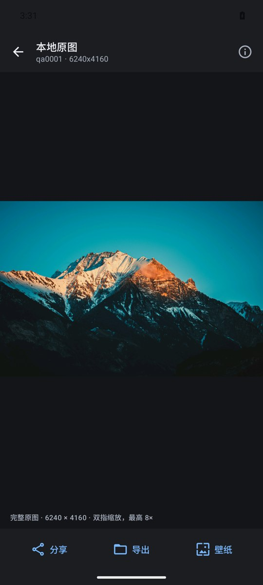

# Android alpha03：后台下载与本地图库

> alpha03 已完成构建与专用模拟器验收。alpha02 的账号能力与真实网站验收限制继续有效；本次没有自动操作真实账号或更换真实设备壁纸。

## 本次范围

- Rust `wh-core` 的可选 `library` 模块统一持久化 SQLite 模式，Android 经 UniFFI 调用。数据库为 `filesDir/library-v1.sqlite3`，WAL、模式版本 1；没有另建 Room 数据模型，也不保存 Key、Cookie 或密码。
- 下载任务按壁纸 ID 去重，保存原图地址、元数据、状态、实际接收字节与可选总量；启动时仅恢复一次中断的 `running` 任务。
- Android WorkManager 顺序执行后台任务，前台服务通知显示实际传输进度，支持暂停、继续、取消及失败手动重试。拒绝通知权限不等于拒绝下载，但系统可能隐藏通知。
- 浏览页、作者作品/收藏集和自己的收藏内容支持确认后批量入队；仅包含确认时已经加载的图片，不继续抓取其他页。详情保存也进入相同队列。
- 本地图库只索引本应用已保存的原图，不扫描整个系统相册；支持关键词（ID/标签/作者/分辨率）、分级、最小宽度、时间/文件大小排序、选择和明确确认的文件删除或仅移除记录。
- 本地图像缩略图与完整原图查看器只读本地 URI，没有远程替代路径。完整原图使用区域/分块解码，支持 EXIF 方向、缩放与平移，不把原图降采样为固定 2000px 文件。
- 可从本地原图分享、经系统文件选择器导出，或在明确确认后调用壁纸接口。验收不执行真实壁纸替换。

## 字节、续传与文件安全

1. 原图加载、保存与队列共用同一磁盘缓存和按 URL 合并的获取路径。缓存命中直接复制原始压缩字节，不再次 GET、不重新编码、不移动共享缓存。
2. 暂停/进程中断保留可校验临时文件；只有强 ETag 或有效 Last-Modified 才尝试 Range + If-Range。必须核对响应验证器、Content-Range 起止/总量以及完整文件格式、长度和哈希。服务器返回完整 200 时从头安全重写，不拼接旧前缀；不合法 206 不提交。
3. 暂停队列不会取消仍有详情查看者需要的共享传输。此时下载拥有者可能等待共享请求完成；不是立刻中断其他窗口的网络。
4. Android 10+ 写入 MediaStore `Pictures/NxWallhaven`，复制完成再发布。持久导出日志用于恢复“发布成功、索引尚未完成”间的崩溃，避免重试重复插入；发布与索引完成相对取消/暂停协调。已发布的不同内容不会被覆盖。
5. Android 8–9 使用应用专属外部图片目录，通常在 `Android/data/<包名>/files/Pictures/NxWallhaven`。它不是公共相册目录，卸载应用会移除应用专属文件；需要保留时先分享/导出。此路径尚未在旧版系统实测。
6. 清图片缓存不清下载文件、图库索引、设置、API Key 或网站会话。取消下载仅清理本任务未发布的临时内容，不删除已经发布的原图。
7. 删除前区分文件确实不存在与暂时不可访问；无读取/删除权限时保留记录，提示到系统相册处理，不把访问失败当成文件丢失。
8. Key/内容权限变更使旧受限下载暂停并关闭受限本地查看；普通 SFW 下载不受影响。Key 存在不代表服务器已验证。

## 已知边界

- 后台执行受 Android 前台服务时长、WorkManager 配额、存储空间和厂商省电策略约束；不承诺无限后台运行。失败任务保留并由用户重试，不做不受控的自动请求循环。
- 原图没有固定响应大小、边长或解码内存上限，但系统、文件系统、物理内存和图像解码器的实际限制仍存在。
- 缓存路径返回后应立即复制；并发手动清缓存或空间回收可能让本次导出失败，失败不会以残缺文件冒充完成，可重试。
- 本地索引不等于桌面图库界面已实现：模式位于共享核心，本次产品接线只在 Android，Windows 发行程序不变。
- 真实网站登录/安全验证、真实账号写入、生产签名、物理设备/OEM、Android 8–9 和真正 16KB 页面设备仍需单独验收。本地夹具和模拟器不能替代这些结论。

## 最终验收与交付

### 自动检查

- `cargo fmt --all -- --check`、`cargo test --workspace -- --test-threads=1`、`cargo clippy --workspace --all-targets -- -D warnings` 均通过。
- Rust **230 项通过**：Android 31、共享核心 42、桌面 121、网站单元 30 / 集成 6；另有既存 7 项忽略，没有将忽略项计为通过。桌面并发缓存清理历史偶发用例本轮按串行全套执行。
- Kotlin **6 项单元测试通过**，包含新增下载 JSON 原图/元数据往返与未知长度进度；`build-android.ps1 -Tests` 双 ABI 构建成功，Lint **0 错误 / 41 警告**。仍有依赖升级、TabRow/测试 API 弃用等提示，导出日志同步 `commit()` 是为崩溃恢复而保留；没有宣称零警告。
- 本地 HTTP 服务回归验证真正的暂停/新实例 Range 续传、精确字节哈希、200 忽略 Range 重启、错验证器/错范围拒绝、Last-Modified、弱/无验证器从头、崩溃多余尾部截断、取消清理、详情/保存单 GET 合并及暂停不伤害其他查看者。
- 新增数据库回归先复现 `missing` 重试仍停在原状态，再修正为可排队；图库旧记录保留到新文件保存成功，不能把失败重试伪装为已下载。

### Android 36 x86_64 专用模拟器

完整 `scripts/test-android-emulator.py` **18 项测试/步骤通过**：

| 范围 | 数量 | 实际验证 |
| --- | ---: | --- |
| 既有浏览与设置 | 4 | 真实只读搜索/分页、完整原图/返回、作者/公开收藏、Key 加密、缓存断网保存与安全清理 |
| 下载/图库 | 4 | 真正 WorkManager 在 Activity 停止时离线保存、拒绝通知后仍可保存、哈希一致与去重、原生本地原图解码、筛选、记录移除/确认文件删除、访问失败保留索引、运行中通知接收器暂停/取消、界面继续、权限撤销暂停、批量取消/确认才入队 |
| 下载进程重启 | 2 | 故意停在原图发布但未完成索引的 `running` 状态，force-stop 后断网、新 PID 恢复，原 URI/哈希不变，MediaStore 只有一项 |
| 网站本地虚拟站点 | 4 | HttpOnly 会话、私有收藏、原生确认和新鲜表单写入、响应丢失只读核对、忙状态失效回归 |
| 网站进程重启 | 2 | force-stop 后 HttpOnly 登录恢复、明确退出后清理完成 |
| 原图缓存进程重启 | 2 | force-stop、新 PID、断网命中原始缓存字节 |

这里的通知控制验证是应用实际显式 BroadcastReceiver/PendingIntent 同路径及原生继续按钮，不是宣称在每种系统通知栏上逐个点按。Range 协议边界在宿主本地 HTTP 测试覆盖，未在真实运营商网络上做故障注入。所有写入/网络开关仅在一次性专用模拟器进行，结束后已恢复网络并关闭自建模拟器，`adb devices` 无残留；本轮 crash buffer 为空。



图为真实专用模拟器截图，显示完整 6240×4160 本地原图；不是设计稿。网站真实账号写入、物理设备、系统分享/文件选择器全链路与真实壁纸效果未在本轮自动验收。

### 交付包

- 路径：`dist/android/NxWallhaven-0.1.0-alpha03-debug.apk`
- 版本：`0.1.0-alpha03` / versionCode 3；minSdk 26、targetSdk 36、compileSdk 37；ARM64 + x86_64。
- 大小：**46,000,933 字节**。
- SHA-256：`20BF48BF8AC6D51DA3520698A5BFE4A33F735A2C07D20E3BA938160170A4AE48`。
- 当前构建 APK 与 dist 副本哈希相同；apksigner 验证有效，与 alpha01/02 使用同一 Android Debug 证书，可直接升级、不必卸载清数据。仍非生产签名。
- `zipalign -c -P 16 -v 4` 和 APK 内全部 6 个 ELF 的 LOAD 段 16KB 对齐检查通过；不是 16KB 物理设备实测。
- Windows EXE 未重建/修改，SHA-256 仍为 `4EAEB3A4B4B3A2FBCDAD01688859E8D8507ADA3539D4E88C7F1454151B1CD907`。

一次可选只读正确性复核超时停止，没有最终报告，不计为审查通过；辅助测试任务也因耗时停止，最终设备用例由主线整理并实际运行。不存在以未返回的子任务结论替代测试通过的说法。

### 复验命令

```powershell
cd D:\Code\wallhaven\rust
cargo fmt --all -- --check
cargo test --workspace -- --test-threads=1
cargo clippy --workspace --all-targets -- -D warnings
cd ..
.\scripts\build-android.ps1 -Tests
$env:JAVA_HOME='D:\Program Files\Android\Android Studio\jbr'
.\gradlew.bat :composeApp:assembleDebugAndroidTest --no-daemon
python .\scripts\test-android-emulator.py
```

专项可用 `--downloads-only` 或 `--site-only`。默认端口 5580；脚本拒绝已占用的目标序列号，不选择物理设备。真实账号验证和厂商后台策略仍由本人在自己的设备上确认。
