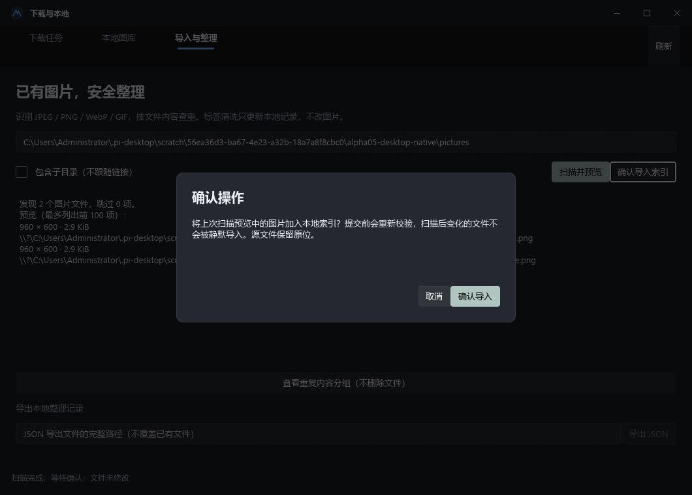
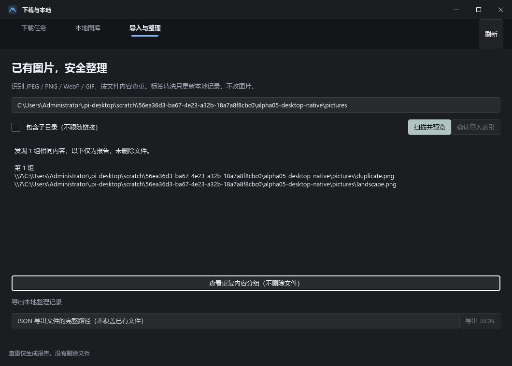

# 剩余功能首轮完善：Windows 本地管理与 Android alpha05

本轮延续既定 Rust + Slint / Android Compose + Rust UniFFI，不重写平台。已交付桌面持久队列、本地管理与共享导入整理；同时按用户反馈完善手机浏览预加载、详情缩略预览和收藏请求复用。**不是所有长期功能一次性完成**，末尾列出仍缺范围。

## 一、手机浏览：提前准备，不等滑到底才请求

旧逻辑仅在距数据尾部约 7 张时请求下一页，且屏外缩略图没有主动准备。新策略：

- 有足够结果时，首屏展示后按序补到至少 3 页（通常 72 条），不是同时开 3 个分页请求；耗尽、重复/空页、错误和代次检查仍有效。
- 后续按可见数量提前保留约 3 屏数据，至少提前 24 条触发补页；先前页还在请求时不重复开始。
- 对接下来数屏缩略图主动预取到同一 Rust 磁盘缓存，最多 4 个预取并发、单次窗口最多 72 个 URL；不是预下载所有原图。
- 已显示缩略图路径有 128 项内存索引，用于详情立即预览；实际图片字节仍在磁盘，不把 RAM 冒充文件缓存。清缓存会清这个索引。
- 滑动续载沿用现有模型、位置和结果去重；没有为了填满屏幕无限抓页。慢速/离线或快速连续滑动仍可能出现等待，不能承诺永不加载。

回归先按旧 7 张阈值失败，再按新策略通过。真正 Compose 画廊测试验证：不滚动时 24→48→72、没有直接爬完全部 120 条；滚动到约第 48 条前后提前补到至少 96 条。

## 二、详情：缩略预览铺底 + 原图真实进度

- 点入详情时先复用已经加载的缩略图；没有索引时和原图并行获取缩略图。
- 预览标明“缩略预览”，完整原图继续走原有共享磁盘缓存/单 URL flight，不以缩略图替代保存或最终显示。
- 进度放在画面下方半透明区域，不再用中央大加载框遮住图片；显示实际接收字节、可选总量、经过测量的速度和预计剩余时间。无总量时使用不确定进度，不编造百分比；缓存命中不编造网络速度。
- 本地完整原图的首批图块真正显示（`onImageLoaded`）后撤下预览，仍保留完整分辨率、分块解码、缩放/平移；不重新编码或降到 2000px。
- 权限变化清掉旧详情/预览并隔离迟到结果；修正系统恢复详情时缩略图状态的初始化顺序。

设备回归先在“只有加载框、没有缩略图”的呈现下超时失败，再验证缩略图已由 Coil 解码显示、底部线性进度存在，原图 ready 后预览/进度撤下。既有真实公开原图显示与返回位置测试仍通过。

## 三、收藏：合并同页校验，移除重复首页请求

旧手机刷新链路会串联多次首页身份核对；打开收藏状态也额外核对首页。现在在**所读取页面本身**同时解析身份和内容：

| 操作 | 当前必要请求（单页夹具） |
| --- | --- |
| 刷新收藏夹 | 1 次 `GET /favorites`，返回 owner 与完整列表；无重复 `GET /` |
| 打开某图收藏状态 | 1 次 `GET /w/<id>`，返回该图状态/网站提供的位置及 owner |
| 同图 30 秒内再次打开 | 0 次请求，账号/代次隔离的内存缓存；最多 32 图 |
| 点击“刷新核对收藏状态” | 强制 1 次图片页 GET |
| 确认收藏写入 | 新鲜图片页 GET → 网站发现的 POST → 同图读取核对；没有额外首页 GET |

- 已知收藏夹摘要可在读取当前图状态期间作为**不可操作参考**显示，不因图片状态未到就重复读取整个收藏夹列表。
- 已成功读取的空收藏夹列表也标为 loaded，导航回来不会因列表为空反复请求；用户明确刷新仍读取最新页面。登录确认保留独立身份步骤，正常会话、列表、API Key 不混为一谈。
- 每页都验证同源、身份、挑战/登录页、体积和分页范围；分页途中换账号拒绝拼接。
- 提交仍重新取表单/CSRF/账号，按唯一收藏位置名称匹配新表单，不拿旧列表下标直接 POST；收藏位置重排回归先复现错误目标后修复，重复名称拒绝写入。
- 打开网页登录、登出、权限变化、写入或未知结果会使缓存失效；响应丢失只读核对，不自动重发 POST。缓存只在内存，不保存 Cookie/CSRF。

Rust 请求计数与安全夹具 6 项、Android mock BrowserTransport + 真 UniFFI/parser 的完整缓存/过期/强刷/空列表/账号切换/丢响应测试均通过。实际 Android WebView 的收藏管理确认与会话恢复也通过。**未自动操作真实账号，不能把请求数减少宣称为用户手机固定毫秒提速或真实网站全部通过。**

## 四、Windows 持久下载与本地管理

主画廊新增“下载与本地”和“批量下载…”：

- 单图详情保存加入同一持久队列；批量确认冻结当前已加载列表，不继续抓更多网页。
- 任务与图库复用共享 Rust SQLite 模式，状态、接收字节和总量落盘；单 worker 顺序执行，暂停/继续/取消/失败重试、重启保留。
- 原图获取复用已有桌面 DiskCache/flight；已加载后断网保存仍复制相同压缩字节，无第二 GET/重编码；暂停队列不取消另一个仍在看的原图。
- 受控临时文件支持强 ETag 或有效 Last-Modified 的 Range + If-Range，核对精确范围/验证器/长度。200 忽略 Range 从头重写；错误范围/验证器不拼接提交。
- 导出 no-replace，不覆盖已有用户文件；文件发布前持久收据，发布后索引未完成的崩溃可根据精确长度/SHA 恢复，不二次保存。删除只针对本任务收据对应且内容未被替换的普通文件；无法访问不当作丢失。
- 记录移除和文件删除分开，后者显示明确不可撤销确认。导入图片只允许移除记录，永不删除其源文件。
- 权限/Key 变化立即暂停旧受限任务并清掉迟到 UI 结果；未知分级按受限处理。关闭主窗口正常收拢子窗口，下载停止不在 UI 线程等待共享网络传输。
- 本地原图可离线独立窗口查看，滚轮指针锚点缩放、拖动/双击适应。完整原图不设固定边长/响应上限、不降采样；缩略图有独立绘制预算，大图缩略失败不删除文件，完整原图仍可单独读取。

默认数据目录 `%APPDATA%/WallHavenStudio/local-data`，隔离环境为 `WH_STUDIO_CONFIG_DIR/local-data`，与图片缓存/相册/网站会话分离。SQLite 是 `library-v1.sqlite3`；下载归属收据在同目录的 `download-destinations-v1`。这些是每端各自文件，不是宣称手机和电脑数据库自动同步。

## 五、共享目录导入、内容查重与标签清洗

`wh_core::catalog` 使用现有 `library` feature 和同个数据库文件的独立表，保留旧 tasks/library 数据和 schema 版本兼容：

1. “导入与整理”输入现有图片目录，可选包含子目录；只读扫描，拒绝符号链接/重解析目录和文件，不走出选定目录。
2. 显示扫描预览和跳过项，**点击确认后才入库**；导入前再次流式校验路径、SHA-256、尺寸、格式，文件变化时整批回滚而不半成功。
3. JPEG/PNG/WebP/GIF 结构读取不展开整张像素，无固定文件体积/边长限制；结构检查不等于所有压缩像素均已完全解码验证。
4. 内容 ID 是 SHA-256，不受 Wallhaven 六位 ID 限制；同内容多文件只增加来源列表。查重仅报告实际仍匹配的来源，不自动删除相似图或重复图。
5. 标签编辑预览规范化后的结果：去首尾/合并空白、小写、去空项和重复、排序；只改本地元数据，不改图片内容/EXIF。
6. 可按文件名/ID/标签/分辨率搜索、时间/大小排序，打开本地原图/目录；可导出本地 catalog JSON，不覆盖已有目标。

扫描最多 10,000 目录项/32 层，超出明确失败而不悄悄截断。导入只建立索引，不移动/复制源文件；用户移动或替换源文件后可用性会重新校验。此批 GUI 接线在 Windows，**Android 的任意目录 SAF 导入/整理界面尚未接入**。

15 项 catalog 测试覆盖持久化、多来源、事务、扫描后变化、损坏、链接/Windows junction、限额、标签和超大尺寸。Slint 组件测试覆盖完整确认流程及 20001×1 原图不降采样。新桌面静态发行包的原生 UIA 隔离验收实际点击扫描 2 文件、确认入库 1 内容项、发现 1 组重复、打开完整 960×600 本地原图，正常关闭自身进程；未扫描/修改真实图片目录。

## 六、手机恢复与 Key 验证

- 全部现有筛选字段及安全版本 schema 存在 SavedStateHandle；当前设置再次限制纯度，不从旧状态恢复内容许可/Key/Cookie。
- 保存安全的路由、壁纸 ID、作者/页签/收藏集 ID、有限历史栈、本地图库筛选/查看项，重新加载数据，不把文件/凭据或整页图片写进系统状态。
- grid index/offset 仅在恢复后已加载数据含该索引时恢复；**深页精确恢复、多个历史作者独立上下文、本地查看 zoom/图库列表位置仍未完整实现**，不为追旧索引自动抓完所有中间页。
- 设置新增明确“验证 API 密钥”只读 `/settings` 服务器验证；保存/有 Key 不代表有效，输入/权限变化使旧验证结果失效。未使用真实 Key 完整验收 NSFW 权限；无效 header 由真实桥接离线拒绝且不泄露值。

## 七、最终验证与安装包

- Rust 全工作区串行 **272 项通过**：Android 35 / core 57 / desktop 138 / site 单元30 + 集成6 + 请求计数6；既有7项忽略不计通过。fmt 和严格 Clippy 全部通过。
- 共享 Kotlin **12 项单元通过**。Android 双 ABI 构建、测试 APK 编译通过，Lint **0错误 / 41警告**，非零警告照实保留。
- 专用 Android36 x86_64 模拟器 **26 项测试/步骤通过**：原有浏览4、恢复/Key4、浏览体验2、请求计数1、下载图库4、下载重启2、WebView网站5、网站重启2、缓存重启2。包括真实公开只读加载、虚拟账号写入和断网/force-stop，不等于真实账号或物理设备通过。
- 发现一项既有 localhost socket 测试继承非阻塞导致偶发 WouldBlock，显式设回阻塞+超时后保持“两图片必须先并发连接才回正文”断言，整套通过。
- 本轮两个未提交文本文件出现 NUL 损坏：模拟器脚本从已提交版本重建并加回入口；队列测试文件重建11项核心回归，主线补回Range/If-Range/200重启/验证器/范围拒绝/Last-Modified/取消清理协议用例。最终全部修改文本NUL扫描为空，不沿用损坏前的测试数量/覆盖结论。
- 做了一次限定安全收敛，修复退出阻塞、收据/索引崩溃缝隙、旧权限快照、记录移除和标签刷新；未把不存在的宽泛审查报告当成通过。

### Android alpha05

- 路径：`dist/android/NxWallhaven-0.1.0-alpha05-debug.apk`
- versionCode5，min26/target36/compile37，ARM64 + x86_64；与 alpha01–04 同 Debug 证书，可覆盖升级，**不要卸载清数据**。
- **58,909,705 字节**，SHA-256 `0E6E6E97951C2F7340861932309DCBCA987CDC95EB47C9C13FC2FFE666D37D3F`。
- 构建/副本哈希一致；签名、ZIP 16KB 和全部6 ELF LOAD段静态16KB对齐有效。非生产签名，未在16KB物理设备验收。

### Windows 新单文件包

- 路径：`dist/WallHavenStudio-0.1.0-windows-x64/WallHavenStudio.exe`
- **37,685,760 字节**，SHA-256 `2C05E18B4997DD0381B2C785EE97EE0157E944F9F7EEB53DFC54148178FD7983`。
- 新静态 CRT x64 GUI 包，PE机型0x8664/子系统2、内嵌图标/版本，无应用配套DLL或VCRUNTIME/MSVCP/UCRT导入；未签名，网页登录仍依赖系统WebView2 Runtime。

## 八、仍缺及实机边界

- 用户真实手机登录/图片冷加载、真实账号收藏写入和当前 Key/NSFW 权限仍需本人复测；本次减少重复请求不代表能够绕过安全验证或保证固定网络速度。
- 持久查询任务/断点增量抓取、元数据自动补齐、可配置筛选清洗规则集/批量编辑、相似图感知查重尚未完成；当前是精确字节重复和手工标签规范化。
- Android 任意目录导入、完整深页/本地缩放恢复、系统壁纸裁切/位置预览尚未完成。
- 手机OEM后台限制、Android8–9、系统分享/SAF导出全链路、壁纸真实效果尚需设备验收；自动轮换、云同步、iOS仍是可选后续。
- 数据库备份/恢复与CSV导出未做，现有JSON导出是catalog元数据，不是完整应用/会话备份。正式签名和分发仍待安排。
